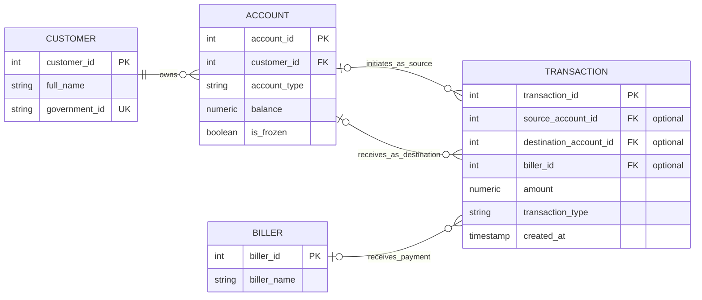

# PayPulse Fintech Platform ER Diagram

## Key and Relationship Definitions

* **PK (Primary Key)**: A column containing a unique identifier for each row in a table. For example, `customer_id` uniquely identifies each registered retail user.
* **FK (Foreign Key)**: A column referencing a primary key in another table to establish a link between entity records. For example, `customer_id` in the `ACCOUNT` table links an account to its owner.
* **UK (Unique Key)**: A constraint enforcing that no two rows contain identical non-null values in that column. For example, `government_id` ensures every customer registers with a distinct identification document.
* **Relationship Symbols**:
  * `||--o{`: Exactly one entity on the left connects to zero, one, or many entities on the right.
  * `|o--o{`: Zero or one entity on the left connects to zero, one, or many entities on the right.

## System Example

Customer Alice has `customer_id = 1001`. She opens a Checking account (`account_id = 501`) and a Savings account (`account_id = 502`). Both rows in the `ACCOUNT` table contain `customer_id = 1001` as a Foreign Key. When Alice transfers \$200 from Checking to Savings, `TRANSACTION` creates a record (`transaction_id = 901`) with `source_account_id = 501`, `destination_account_id = 502`, and `biller_id = NULL`.

## Optional Fields

* `source_account_id`: Optional (`NULL` for external cash deposits into an account).
* `destination_account_id`: Optional (`NULL` for cash withdrawals or utility bill payments).
* `biller_id`: Optional (`NULL` for deposits, withdrawals, and peer-to-peer account transfers; populated only when `transaction_type = 'Payment'`).

## Rules Requiring Additional Transaction Logic or Triggers

* **Rule 5 (Available Balance Validation)**: Checking that transfer `amount <= balance` spans multiple entity rows and cannot be enforced by standard column constraints alone. It requires database trigger validation or application transaction logic prior to updating balances.
* **Rule 7 (Frozen Account Enforcement)**: Keys cannot evaluate status flags across tables; database trigger logic must verify `is_frozen = FALSE` on both source and destination accounts before inserting a transaction.
* **Rule 8 (Immutable Timestamps)**: Timestamp consistency relies on database trigger routines setting `created_at = CURRENT_TIMESTAMP` and restricting `UPDATE` privileges on committed records.