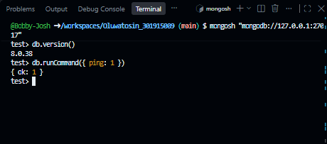

# MongoDB setup

MongoDB runs in the existing Ubuntu Codespace, alongside PostgreSQL.
The server version is 8.0.38. Its data folder is /workspaces/mongodb-data,
outside the repository. Connections use 127.0.0.1; port forwarding is off.

## Start and connect

```bash
mongod --dbpath /workspaces/mongodb-data --logpath /workspaces/mongodb-data/mongod.log --logappend --bind_ip 127.0.0.1 --fork
mongosh "mongodb://127.0.0.1:27017"

## Connection check

`db.version()` returns `8.0.38` and `db.runCommand({ ping: 1 })` returns `{ ok: 1 }`.



## Reference

* [MongoDB Ubuntu installation guide](https://www.mongodb.com/docs/v8.0/tutorial/install-mongodb-on-ubuntu/) — MongoDB, Inc. (2026). *Install MongoDB Community Edition on Ubuntu (MongoDB Database Manual v8.0)*.
* [MongoDB Shell (`mongosh`) connection guide](https://www.mongodb.com/docs/mongodb-shell/connect/) — MongoDB, Inc. (2026). *Connect to a Deployment*.
* [MongoDB Ubuntu APT repository](https://repo.mongodb.org/apt/ubuntu/) — Official package source referenced in `Ijimakinwa_Oluwatosin_301915009_P4_MongoDBSource.list`.