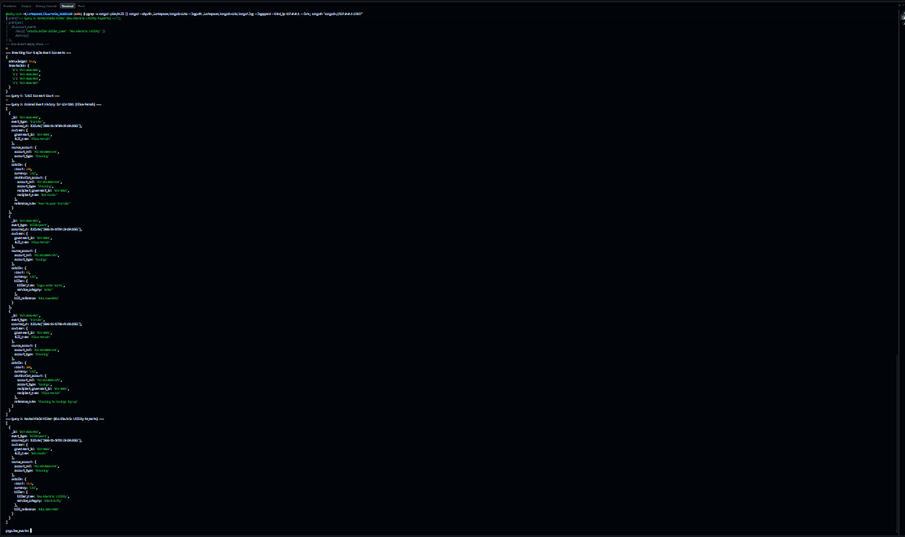

# Portfolio 4 NoSQL and Advanced Data Models

## Document model

For the **PayPulse** fintech platform, activity records are stored in a single MongoDB database (`paypulse_events`) and collection (`account_events`) rather than splitting events across normalized relational tables. Each document represents one discrete customer financial event (`Transfer` or `BillPayment`) using a unique string `_id`, shared top-level metadata (`event_type`, `occurred_at`), embedded summary subdocuments (`customer`, `source_account`), and a polymorphic `details` object whose internal fields vary by `event_type`.

These four MongoDB documents are standalone fictional records created for Portfolio 4. They reuse valid customer, account-type, and biller identifiers from [Portfolio 1 SampleData.sql](../portfolio-1-database-design/Oluwatosin_Ijimakinwa_301915009_P1_SampleData.sql) (`GOV-1001`, `GOV-1002`, `Alice Mensah`, `Bob Okafor`, `Checking`, `Savings`, `Eko Electric Utility`, `Lagos Water Works`) for domain consistency rather than being exported from PostgreSQL (`paypulse_portfolio`).

| Field Path | BSON Type | Scope | Purpose |
| :--- | :--- | :--- | :--- |
| `_id` | `String` | Shared | Unique event identifier (`EVT-2026-001` to `EVT-2026-004`). |
| `event_type` | `String` | Shared | Discriminator field: `"Transfer"` or `"BillPayment"`. |
| `occurred_at` | `Date` | Shared | Fixed UTC `ISODate` timestamp when the event occurred. |
| `customer` | `Object` | Shared | Embedded initiating customer (`government_id`, `full_name`). |
| `source_account` | `Object` | Shared | Embedded originating account (`account_ref`, `account_type`). |
| `details` | `Object` | Polymorphic | Event-specific payload (`amount`, `currency`, plus type-specific fields). |
| `details.destination_account` | `Object` | `Transfer` | Recipient account details (`account_ref`, `account_type`, `recipient_government_id`, `recipient_name`). |
| `details.reference_note` | `String` | `Transfer` | Short memo describing the transfer. |
| `details.biller` | `Object` | `BillPayment` | Embedded utility provider (`biller_name`, `service_category`). |
| `details.bill_reference` | `String` | `BillPayment` | Utility invoice or meter reference code. |

### Example document (`BillPayment`)

```json
{
  "_id": "EVT-2026-002",
  "event_type": "BillPayment",
  "occurred_at": "2026-11-10T11:30:00.000Z",
  "customer": {
    "government_id": "GOV-1002",
    "full_name": "Bob Okafor"
  },
  "source_account": {
    "account_ref": "ACC-GOV1002-CHK",
    "account_type": "Checking"
  },
  "details": {
    "amount": 75.5,
    "currency": "USD",
    "biller": {
      "biller_name": "Eko Electric Utility",
      "service_category": "Electricity"
    },
    "bill_reference": "BILL-EKO-4401"
  }
}

## Implementation and results

The script [Oluwatosin_Ijimakinwa_301915009_P4_MongoDB.js](Oluwatosin_Ijimakinwa_301915009_P4_MongoDB.js) was executed in `mongosh` connected to the local MongoDB 8.0.38 instance (`mongodb://127.0.0.1:27017`) while leaving PostgreSQL untouched:

1. **Database selection and pre-insert check:** `db.getSiblingDB("paypulse_events")` selected the target database, and `db.account_events.countDocuments({})` returned `0`, confirming the collection was empty before loading data.
2. **Single bulk insert:** `db.account_events.insertMany([...])` inserted all four events in one operation (`acknowledged: true`), returning inserted IDs `'EVT-2026-001'`, `'EVT-2026-002'`, `'EVT-2026-003'`, and `'EVT-2026-004'`.
3. **Query 1 — Total document count:** `db.account_events.countDocuments({})` returned `4`.
4. **Query 2 — Customer ordered event history:** `db.account_events.find({ "customer.government_id": "GOV-1001" }).sort({ occurred_at: 1 })` returned **3 documents** for Alice Mensah in chronological order:
   * `EVT-2026-001` (`2026-11-10T09:15:00.000Z`): `Transfer` of `$250` USD to Bob Okafor (`ACC-GOV1002-CHK`).
   * `EVT-2026-003` (`2026-11-11T14:20:00.000Z`): `BillPayment` of `$42` USD to `Lagos Water Works` (`BILL-LWW-8812`).
   * `EVT-2026-004` (`2026-11-12T16:45:00.000Z`): `Transfer` of `$300` USD to Alice's Savings account (`ACC-GOV1001-SAV`).
5. **Query 3 — Nested-field filter:** `db.account_events.find({ "details.biller.biller_name": "Eko Electric Utility" })` traversed two nested object levels inside `details` and returned **1 matching document**: `EVT-2026-002` (`2026-11-10T11:30:00.000Z`, paid by Bob Okafor for `$75.5` USD under reference `BILL-EKO-4401`).



## Why MongoDB fits

**Suitability for PayPulse event streams:**
* **Polymorphic payload flexibility:** In the relational schema, `public.transaction` requires nullable foreign keys (`destination_account_id`, `biller_id`) that remain `NULL` depending on the transaction category. MongoDB stores `Transfer` and `BillPayment` events together in `account_events`, allowing `details` to hold only the subdocument (`destination_account` or `biller`) relevant to each event type.
* **Single-read timeline retrieval:** Embedding customer and source-account attributes inside each event document eliminates multi-table joins when querying a customer's chronological activity feed (`customer.government_id` sorted by `occurred_at`) and preserves an immutable point-in-time snapshot for compliance auditing.

**Key limitation:**
* **Not suited for authoritative ledger balance enforcement:** Because MongoDB does not enforce declarative cross-collection foreign keys or relational `CHECK` constraints across accounts, it is poorly suited as PayPulse's primary system of record for real-time balance checks (`amount <= balance`) or account freeze enforcement (`is_frozen = FALSE`). Additionally, embedding `full_name` and `biller_name` introduces controlled duplication that would require multi-document updates if historical labels needed correction.

## Files

* [Oluwatosin_Ijimakinwa_301915009_P4_README.md](Oluwatosin_Ijimakinwa_301915009_P4_README.md) — Portfolio 4 document model design, query results, suitability analysis, and references.
* [Oluwatosin_Ijimakinwa_301915009_P4_Setup.md](Oluwatosin_Ijimakinwa_301915009_P4_Setup.md) — Local MongoDB 8.0.38 startup instructions and connection verification.
* [Oluwatosin_Ijimakinwa_301915009_P4_MongoDBSource.list](Oluwatosin_Ijimakinwa_301915009_P4_MongoDBSource.list) — Official MongoDB 8.0 APT repository configuration used during installation.
* [Oluwatosin_Ijimakinwa_301915009_P4_MongoDB.js](Oluwatosin_Ijimakinwa_301915009_P4_MongoDB.js) — `mongosh` script containing the empty check, `insertMany` batch, and three verification queries.
* [screenshots/Oluwatosin_Ijimakinwa_301915009_P4_MongoDBConnection.png](screenshots/Oluwatosin_Ijimakinwa_301915009_P4_MongoDBConnection.png) — Terminal verification of `db.version()` (`8.0.38`) and `ping` (`{ ok: 1 }`).
* [screenshots/Oluwatosin_Ijimakinwa_301915009_P4_MongoDBQueries.png](screenshots/Oluwatosin_Ijimakinwa_301915009_P4_MongoDBQueries.png) — Terminal output showing execution of the `account_events` queries.

## References

* MongoDB, Inc. (2026). *Data Modeling Introduction (MongoDB Manual v8.0)*. https://www.mongodb.com/docs/v8.0/core/data-modeling-introduction/
* MongoDB, Inc. (2026). *Query on Embedded/Nested Documents (MongoDB Manual v8.0)*. https://www.mongodb.com/docs/v8.0/tutorial/query-embedded-documents/
* MongoDB, Inc. (2026). *Install MongoDB Community Edition on Ubuntu (MongoDB Manual v8.0)*. https://www.mongodb.com/docs/v8.0/tutorial/install-mongodb-on-ubuntu/